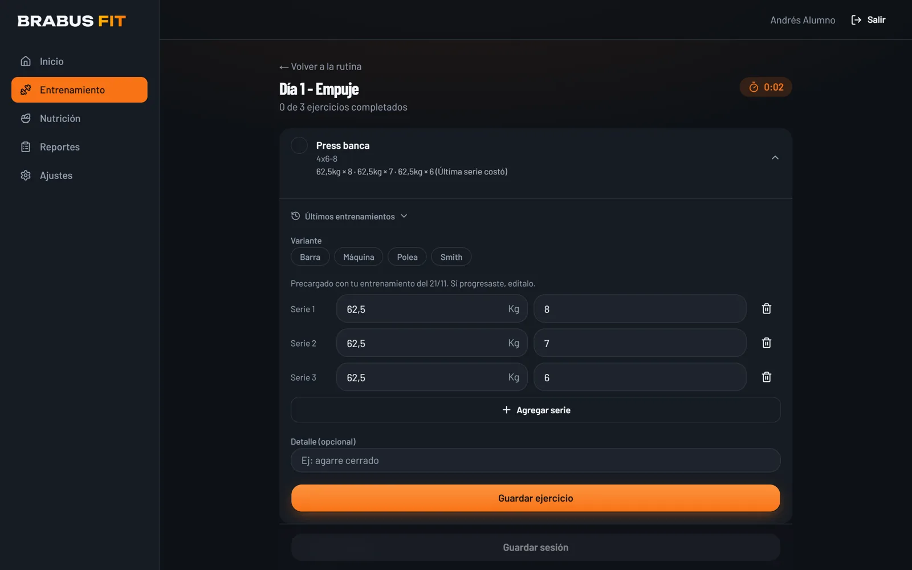
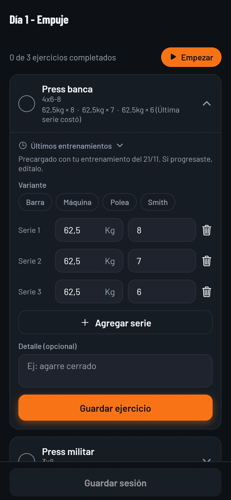
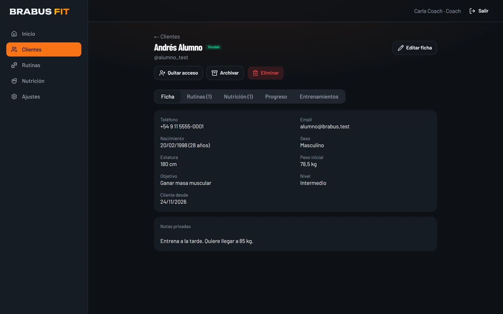
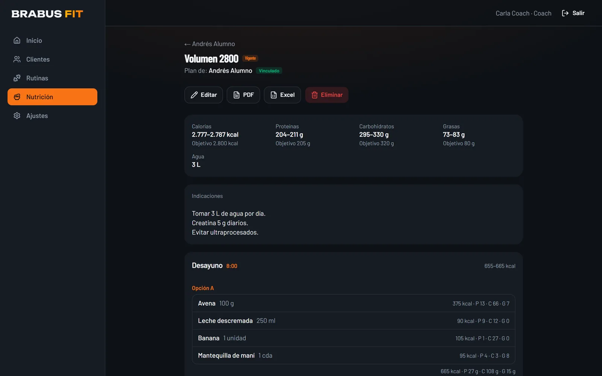
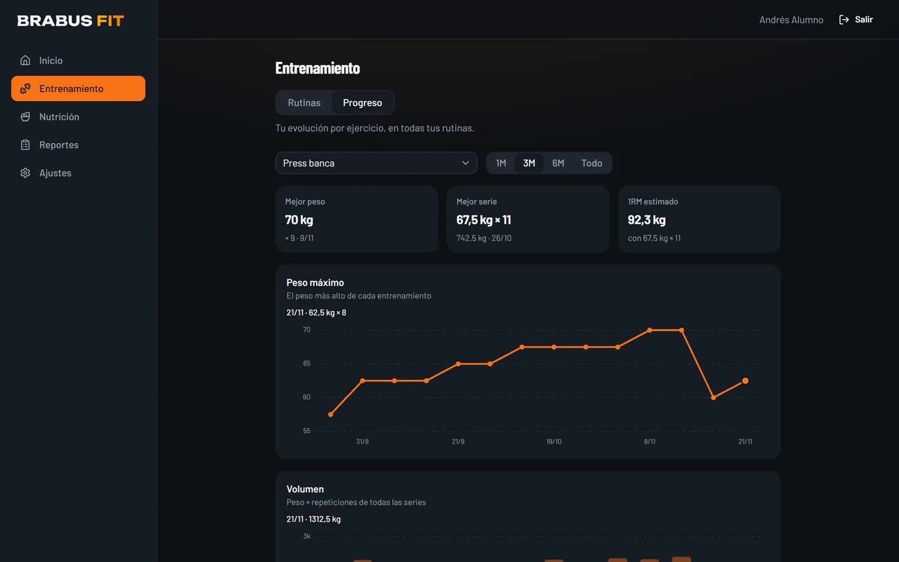
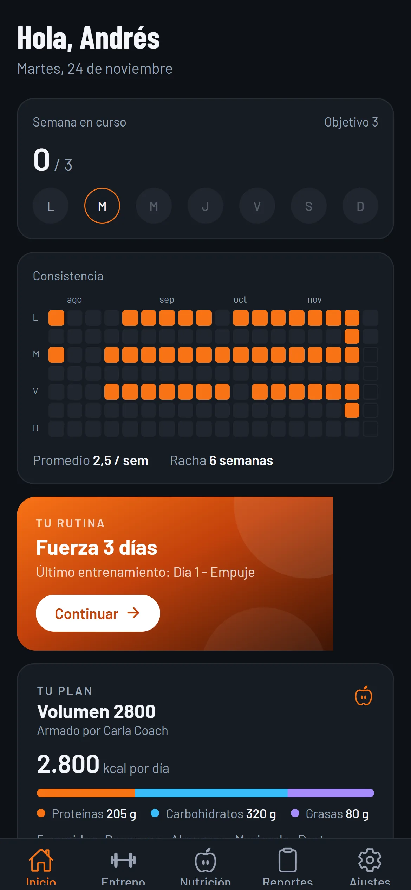
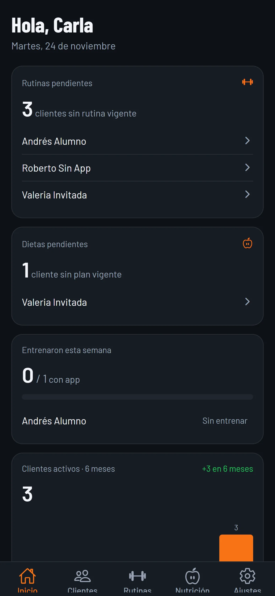
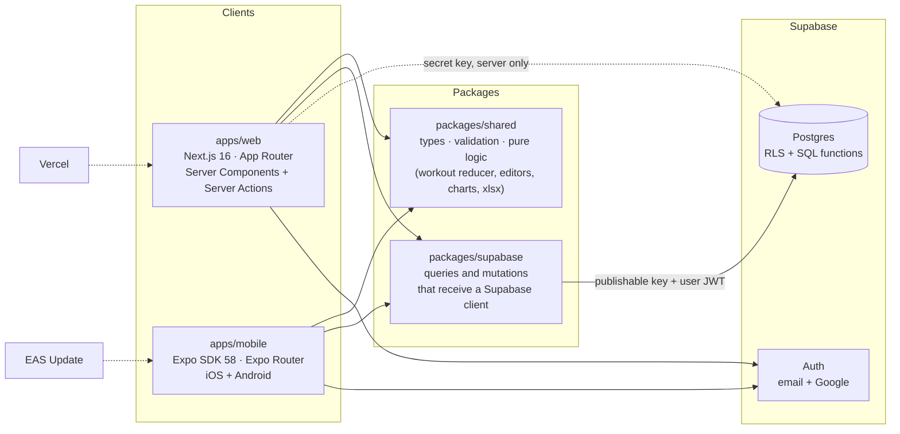

<div align="center">

# Brabus Fit

**Training and nutrition plans for coaches and their clients, on web and mobile, from one codebase.**

[](https://github.com/franfocaraccio/brabusfit/actions/workflows/ci.yml)
[](https://github.com/franfocaraccio/brabusfit/actions/workflows/ci.yml)
[](https://github.com/franfocaraccio/brabusfit/actions/workflows/codeql.yml)
[](LICENSE)


[**Live demo (web)**](https://brabusfit.vercel.app) · [Architecture](docs/ARCHITECTURE.md) · [Setup](SETUP.md)

</div>

<p align="center">
  
  &nbsp;
  
</p>

> The UI is in Spanish (the app is built for coaches in Argentina); the code, docs and commits are in English.

## What it does

Brabus Fit replaces the spreadsheet + WhatsApp workflow many personal trainers use. A coach keeps a file for each client and builds their routines and meal plans; the client trains with the app and logs every set, and the coach sees their progress.

### For coaches
- **Clients (mini CRM):** a file per client (contact, body data, goal, level, injuries, private notes). Clients don't need to use the app: routines and plans export to **PDF and Excel**.
- **Templates + per-client copies:** build routines and nutrition plans as templates in folders, then assign them. Each client gets an **independent copy** that can be tailored without touching anyone else's.
- **Invitations:** invite a client to the app by email or username; they see their plans once they accept.
- **Dashboard:** clients without a current routine or plan, who trained this week, active clients over the last 6 months.
- **Client progress:** the same charts the student sees, read-only.

### For students
- **Train:** each session is preloaded with the last one. Log weight and reps per set, mark sets done to start the rest timer the coach set, and save.
- **Never lose a session:** a local draft survives closing the tab or the app (24 h), and leaving with unsaved changes asks first.
- **Progress:** best weight, best set, estimated 1RM, max-weight line, weekly volume and frequency per exercise, across all routines.
- **Nutrition:** the current plan with meals, A/B options and macro totals.
- **Own routines:** students can also build their own; if a coach unlinks, the student **keeps a copy** of everything with their history.

## Screenshots

| Coach — client file | Coach — nutrition plan | Student — progress |
|---|---|---|
|  |  |  |

| Mobile — student home | Mobile — workout | Mobile — coach home |
|---|---|---|
|  |  |  |

All screenshots use the invented data from [`supabase/seed.sql`](supabase/seed.sql).

### Try it
- **Web:** [brabusfit.vercel.app](https://brabusfit.vercel.app). Use one of the demo accounts below; their data is invented and gets reset every so often.

  | Role | Email | Password |
  |---|---|---|
  | Coach | `coach.demo@brabusfit.test` | `brabusfit-demo` |
  | Student | `alumno.demo@brabusfit.test` | `brabusfit-demo` |

  The coach has three clients, templates in folders, client routines and a nutrition plan. The student is one of those clients and has ten weeks of logged workouts. The accounts are created by [`scripts/seed-demo.ts`](scripts/seed-demo.ts), which goes through the app's own data layer.
- **Mobile:** the app is published with EAS Update and opens in **Expo Go**. Access to the published build is by invitation to the Expo organization (scan [`docs/expo-go-qr.png`](docs/expo-go-qr.png) once invited); anyone can run it locally, see [Quick start](#quick-start).

## Architecture



- **One data layer, two apps.** Every query and mutation lives in [`packages/supabase`](packages/supabase/src) as a function that receives the client. The web calls it from Server Actions (and adds cache revalidation); the mobile app calls it directly.
- **Security lives in the database.** Row Level Security decides who sees what, so the mobile app ships only the *publishable* key. The secret key never leaves the web server.
- **Platform-independent logic is pure TypeScript** in [`packages/shared`](packages/shared/src): the day-trainer state, the routine and plan editors, progress stats, macro totals, the draft backup. Each app only adds its UI and a thin hook.

More detail: [docs/ARCHITECTURE.md](docs/ARCHITECTURE.md) has the ER diagram, the role and RLS model, and the auth flows.

## Engineering highlights

- **RLS-first multi-tenancy.** Each table has policies built on small `SECURITY DEFINER` helpers (`has_routine_access`, `is_my_student`, …). Writes that touch several tables go through atomic SQL functions (`create_full_routine`, `save_full_plan`, `update_session_logs`). See [`supabase/migrations`](supabase/migrations).
- **Copies, not shared references.** Assigning a template creates an independent copy per client. When a coach and a student unlink, the student keeps their own copy and the workout history moves with it ([`0011_keep_routines_on_unlink.sql`](supabase/migrations/0011_keep_routines_on_unlink.sql)). This is covered by RLS tests.
- **The database is tested like code.** [RLS and integration tests](packages/supabase/test) run against a real local Supabase. Every run registers fresh users with the publishable key, just like the mobile app. They check that a coach never sees another coach's data, a student sees only their own, and anonymous users read nothing.
- **Generated types, refined by hand.** [`database.generated.ts`](packages/shared/src/database.generated.ts) comes from the migrations. CI fails if it drifts. [`database.ts`](packages/shared/src/database.ts) narrows `check`-constrained columns and JSON RPC arguments with `type-fest`'s `MergeDeep`.
- **Safe production migrations.** Migrations never run on push. A [manual workflow](.github/workflows/db-migrate.yml), gated by a GitHub environment, shows a dry run first and only applies with an explicit checkbox.
- **Refactor behind characterization tests.** The three largest screens (day trainer, routine builder, plan builder) were 500–1,100 lines each. Their behavior was pinned with characterization tests first. The logic then moved to pure reducers in `packages/shared`, and the components came down to about 300 lines or less, with no behavior change ([PRs #5–#7](https://github.com/franfocaraccio/brabusfit/pulls?q=is%3Apr+refactor)).
- **Few dependencies where they're easy to avoid.** The progress charts are hand-written SVG (web `svg`, mobile `react-native-svg`). The `.xlsx` export is a [small zip/XML writer](packages/shared/src/xlsx.ts).

## Tech stack

| Area | Tools |
|---|---|
| Web | Next.js 16 (App Router, Server Actions), React 19, Tailwind CSS v4, shadcn/ui on Base UI, dnd-kit, jsPDF |
| Mobile | Expo SDK 58, React Native 0.88, Expo Router, expo-print / expo-sharing, react-native-svg |
| Backend | Supabase: Postgres, Row Level Security, SQL functions, Auth (email + Google OAuth with PKCE) |
| Monorepo | npm workspaces, Turborepo, TypeScript (strict) |
| Quality | Vitest, Testing Library, ESLint, Prettier, GitHub Actions |
| Deploy | Vercel (web), EAS Update (mobile) |

## Testing

| Suite | What it covers | Command |
|---|---|---|
| Unit (`packages/shared`) | Pure logic: workout reducer, routine and plan editors, progress stats, nutrition totals, drafts, export | `npm test` |
| Component (`apps/web`) | Characterization tests of the day trainer, routine builder and plan builder | `npm test` |
| Database (`packages/supabase/test`) | RLS isolation between coaches and students, anonymous access, unlink handover, data-layer integration | `npm run test:db` |
| End-to-end (`apps/web/e2e`) | Playwright: a coach creates a template and assigns it, the student trains it and saves the session, the coach sees it in the client file | `npm run e2e` |

[CI](.github/workflows/ci.yml) runs these jobs on every PR:

1. **Checks:** lint, typecheck, unit tests with coverage and the web build.
2. **Database:** starts a fresh Supabase, applies every migration from scratch, checks the generated types and runs the RLS and integration tests.
3. **E2E:** builds the web against a fresh local Supabase and runs the Playwright flow.
4. **Mobile:** `expo-doctor` and typecheck.
5. **Coverage:** combines the line coverage of the unit, component and database suites into the job summary. On `main` it also publishes the badge.

On top of CI, [CodeQL](.github/workflows/codeql.yml) scans the code on every PR and weekly. [Dependabot](.github/dependabot.yml) opens grouped weekly updates; Expo, React and React Native are left out because they move together with the Expo SDK.

## Quick start

Requires Node 20+ and Docker (for the local Supabase).

```bash
npm install            # always from the root (npm workspaces)
npm run db:start       # local Supabase: applies migrations + seed
npm run local:web      # web on http://localhost:3001 against the local DB
npm run local:mobile   # mobile (web build) on http://localhost:8081
```

Seed users (password `brabus-test-123`): `coach@brabus.test` and `alumno@brabus.test`, plus a second coach and student. To run on a phone with Expo Go, use `npm run dev:mobile`.

```bash
npm test               # unit and component tests
npm run test:db        # RLS + integration tests (needs db:start)
npm run e2e            # Playwright E2E (needs db:start; starts the web on :3001)
npx turbo run typecheck lint
```

Environment variables, production setup, Google sign-in and EAS are covered in [SETUP.md](SETUP.md).

## Project structure

```
apps/
  web/              Next.js app (Vercel, Root Directory: apps/web)
  mobile/           Expo app (iOS + Android)
packages/
  shared/           Types, validation and pure logic shared by both apps
  supabase/         Data layer: functions that receive a Supabase client, plus DB tests
supabase/
  migrations/       Schema, RLS policies and SQL functions (single source of truth)
  seed.sql          Invented data for local development
docs/               Architecture, roadmap, screenshots
.github/workflows/  CI and the manual production migration workflow
```

## AI-assisted development

I built this project with an AI coding assistant ([Claude Code](https://claude.com/claude-code)) as a pair programmer. I decide the product, the data model and the architecture, review every change, and merge every PR myself. The assistant writes much of the code under rules kept in the repo ([`AGENTS.md`](AGENTS.md)):
- security in the database
- web/mobile parity
- every schema change through a tested migration
- the verification to run before each commit

The guardrails are what keep it honest:
- strict TypeScript and generated DB types
- RLS tests against a real database
- characterization tests before any refactor
- CI on every PR
- small, reviewable PRs, one per phase of work

## Roadmap

Next modules:
- **Weekly check-ins:** weight, measurements and progress photos in private Supabase Storage.
- **Client payments:** fees and due dates per client.
- **Exercise media:** photos and videos.
- **Progression alerts.**
- **Native builds:** EAS Build, with push notifications and native Google sign-in.

The full list is in [GitHub Issues](https://github.com/franfocaraccio/brabusfit/issues?q=is%3Aissue+is%3Aopen+label%3Aenhancement); [docs/ROADMAP.md](docs/ROADMAP.md) groups it by area and keeps the architecture decisions.

## License

[MIT](LICENSE) © Francisco Focaraccio
