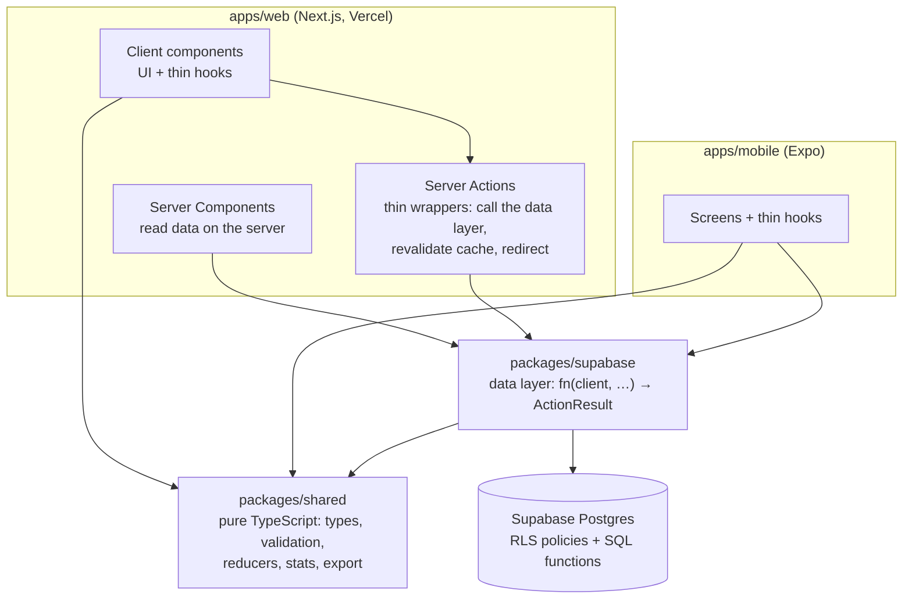
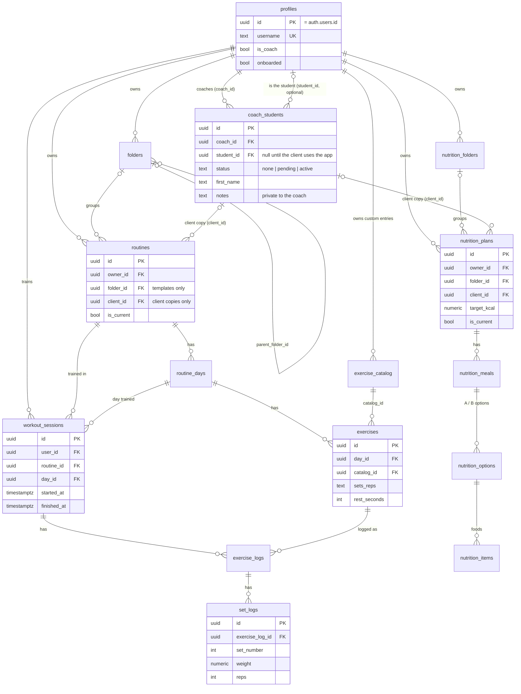
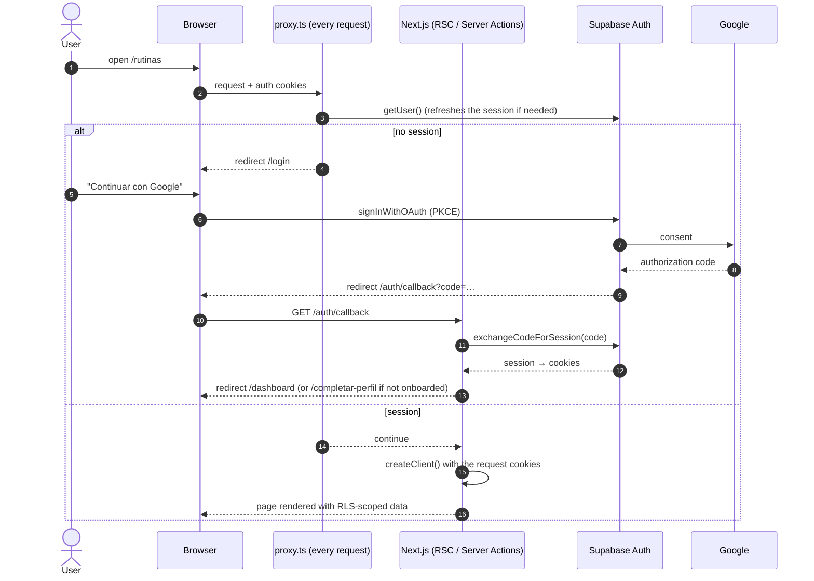

# Architecture

How Brabus Fit is put together: the layers, the data model, who can see what, and how users sign in. For setup, see [SETUP.md](../SETUP.md). For the product overview, see the [README](../README.md).

## Layers

| Layer | Owns | Does not own |
|---|---|---|
| `supabase/migrations` | Schema, RLS policies, SQL functions for multi-table writes and access checks | Any UI concern |
| `packages/shared` | Types (generated + refined), validation, pure logic shared by both apps (workout reducer, routine/plan editors, progress stats, nutrition totals, local drafts, PDF/XLSX data) | I/O of any kind |
| `packages/supabase` | Every query and mutation, as a function that receives a Supabase client and returns typed data or an `ActionResult` | Platform APIs, caching, navigation |
| `apps/web` | Pages, components, Server Actions (cache revalidation, redirects, server-only email) | Business rules |
| `apps/mobile` | Screens, native APIs (haptics, alerts, sharing, printing), local storage | Business rules |

Because the data layer takes the client as an argument, both apps share it. The web passes a server client bound to the request cookies; the mobile app passes a client that uses the publishable key and the stored session.

## Data model

The diagram shows the main tables and relationships. Timestamps and some descriptive columns are omitted. The generated types in [`database.generated.ts`](../packages/shared/src/database.generated.ts) are the full reference.

### Templates and per-client copies

There is no "shared routine". A coach's routine without a client is a **template** and lives in a folder that nobody else sees. Assigning a template to a client calls `copy_routine` (or `copy_nutrition_plan`), which creates an **independent copy** with `client_id` set. Editing that copy affects only that client.

`coach_students` is the client's file. It exists even if the person never installs the app. Access to the app is optional and lives in the same row:
- `none`: the client doesn't use the app.
- `pending`: an invitation was sent by email or username.
- `active`: the student accepted.

When an active link ends, the student keeps their copies:
- **Who can end it:** either side (the coach removes access or archives the client, or the student leaves).
- **What the student gets:** `_hand_over_routines` and `_hand_over_plans` copy every routine and plan into the student's own account. The workout history moves to those copies, and custom catalog exercises are copied too.
- **What the coach keeps:** their copy, under the now-unlinked client.

## Roles and Row Level Security

Every table has RLS enabled. Policies call small `SECURITY DEFINER` SQL functions, so the rules stay readable and are reused across tables.

| Actor | Can read | Can write |
|---|---|---|
| Anonymous | Nothing | Nothing (only sign up / sign in through Auth) |
| Student | Their profile, routines and plans assigned to them **while the link is active** (`has_routine_access`, `has_plan_access`), their own routines, their sessions and logs, their coaches via `get_my_coaches()` | Their own routines and sessions; the logs of their own sessions |
| Coach | Their clients' files (`coach_students.coach_id = auth.uid()`), their templates and client copies (`is_routine_owner`, `is_plan_owner`), sessions of **actively linked** students on routines they own (`is_routine_owner` + `is_active_link`) | Their templates, client copies, client files and invitations |
| Web server (secret key) | Bypasses RLS. Used only on the server for tasks that need it (e.g. emails); never shipped to a client | Same |

Some details:
- **Students never read `coach_students`.** That row holds the coach's private notes. Students get their coaches through the `get_my_coaches()` function, which returns only the link and the coach's name.
- **The exercise catalog is general plus private.** General entries (`owner_id is null`) are visible to everyone signed in; custom entries are visible only to their owner.
- **Multi-table writes are atomic SQL functions** (`create_full_routine`, `update_full_routine`, `save_full_plan`, `update_session_logs`, `save_client`, `invite_client`, `respond_invitation`). They check access themselves and run in one transaction.

These rules are tested against a real Postgres in [`packages/supabase/test/rls.test.ts`](../packages/supabase/test/rls.test.ts):
- coach A can't read coach B's data
- a student reads only their own
- anonymous users read nothing from 14 tables
- unlinking leaves the student with their routines

A mutation check confirms the tests have teeth: loosening a single policy makes them fail.

## Authentication

Supabase Auth handles email/password and Google OAuth. Email confirmation is off until the project has a domain for transactional email. A database trigger (`handle_new_user`) creates the `profiles` row on sign-up, taking the name from the sign-up form or from Google.

### Web

- [`proxy.ts`](../apps/web/src/proxy.ts) (Next.js 16's replacement for middleware) refreshes the session on every request. It redirects to `/login` when a private route has no session, and to `/dashboard` when a signed-in user opens `/login` or `/signup`.
- First-time Google users go to `/completar-perfil` until `profiles.onboarded` is true.

### Mobile

- Email/password uses `supabase-js` with the publishable key. The session is stored with `expo-sqlite` storage (`localStorage` on the web build).
- Google sign-in opens the system browser with `expo-web-browser`. Supabase redirects back to the app (`exp://u.expo.dev/…` in Expo Go, `brabusfit://` in native builds) with a PKCE code. The app exchanges it with `exchangeCodeForSession`.
- Every request carries the user's JWT, and RLS applies exactly as on the web.

## Schema changes and types

1. **Write a migration.** New file in `supabase/migrations/` (numbered, e.g. `0016_…sql`).
2. **Test it locally.** `npm run db:reset` applies every migration plus the seed, then `npm run test:db` runs the RLS and integration tests.
3. **Regenerate the types.** `npm run db:types` writes `packages/shared/src/database.generated.ts`. Narrower types for `check`-constrained columns and JSON RPC arguments go in `database.ts`.
4. **CI.** It starts a clean database, applies all migrations, regenerates the types and fails if they differ from the committed file.
5. **Production.** After merging to `main`, run the [manual workflow](../.github/workflows/db-migrate.yml). It shows a dry run and applies only when `apply` is checked, inside the protected `production` environment.

## Testing strategy

| Level | Tool | Lives in |
|---|---|---|
| Pure logic | Vitest | `packages/shared/src/*.test.ts` |
| UI behavior (web) | Vitest + Testing Library (jsdom) | `apps/web/src/components/**/*.test.tsx` |
| Database: RLS + data layer | Vitest against local Supabase | `packages/supabase/test` |
| Type contracts | `expectTypeOf` | `packages/shared/src/database.test.ts` |

The web component tests are **characterization tests**. They were written against the code as it was, before the refactor of the three biggest screens. They pin the exact payloads sent to the server and the user-facing flows: drafts, unsaved-changes guards, rest timer, progress pop-ups. Mobile screens reuse the same reducers from `packages/shared`, so their logic is covered by the unit tests.
